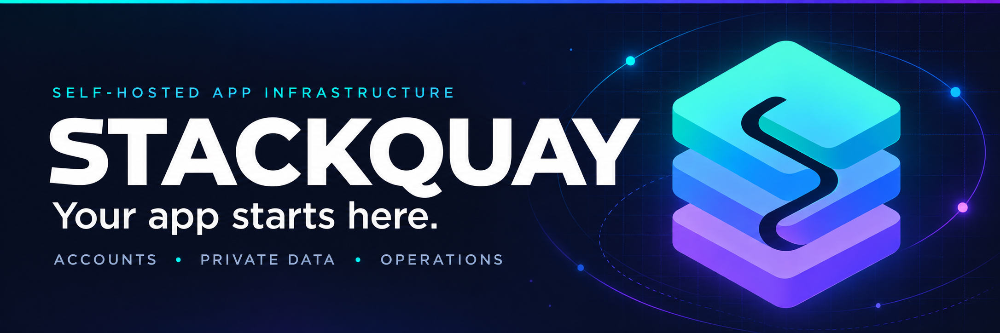
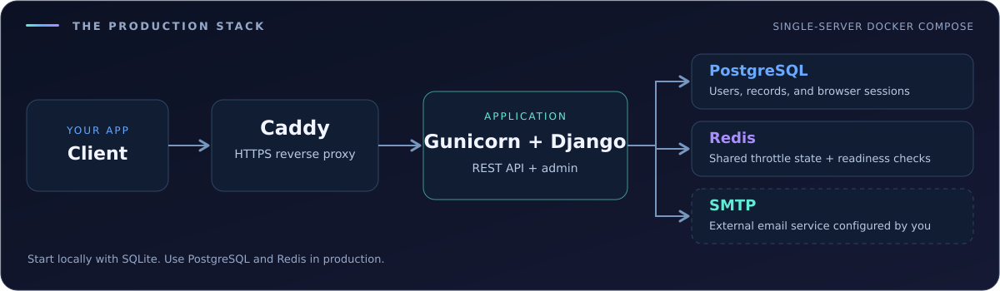
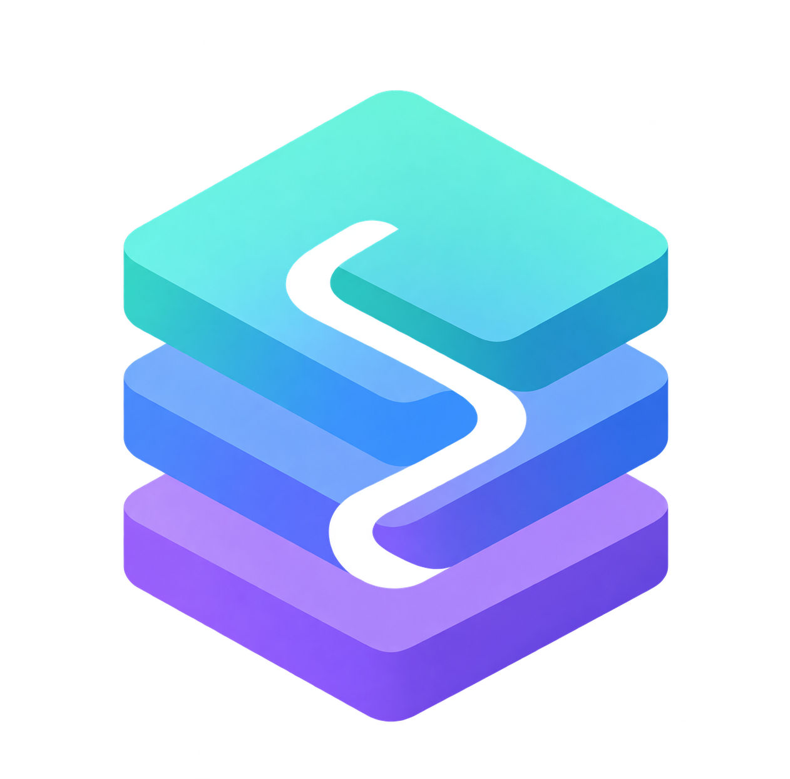

<a id="top"></a>

<p align="center">
  
</p>

<div align="center">

# Stackquay

**Self-hosted application infrastructure for your next app.**

User accounts. Private data. Trusted administration. A practical path to production.

[](https://github.com/keepithandy/stackquay/actions/workflows/ci.yml)
[](https://github.com/keepithandy/stackquay/releases/latest)
[](#production)
[](LICENSE)


**[Quickstart](#install-and-run) · [Features](#what-you-get) · [API](#first-api-request) · [Architecture](#architecture) · [Deploy](#production) · [Guides](#guides)**

</div>

---

Build on Python 3.12, Django 5.2 LTS, and Django REST Framework. Start locally with SQLite, then use the included Docker Compose stack for PostgreSQL, Redis, Gunicorn, and Caddy on one Linux server.

**Start your own app:** use GitHub's **Use this template** button, or fork the repository. Keep the foundations and make the data model your own.

## What you get

<table>
  <tr>
    <td width="50%" valign="top">
      <h3>🔑 Accounts, ready to extend</h3>
      Username/password login, optional email-verified signup, profiles, password changes, email recovery, expiring sessions, and logout.
    </td>
    <td width="50%" valign="top">
      <h3>🗂️ Private data by default</h3>
      An owner-scoped records API with create/read/update/delete, UUIDs, validation, search, status filters, sorting, and pagination.
    </td>
  </tr>
  <tr>
    <td width="50%" valign="top">
      <h3>🛠️ Trusted administration</h3>
      Django's admin dashboard for users, groups, permissions, records, token revocation, and built-in admin change history.
    </td>
    <td width="50%" valign="top">
      <h3>⚓ Practical operations</h3>
      Automatic HTTPS through Caddy, static assets, health probes, structured request logs, and database backup and restore commands.
    </td>
  </tr>
  <tr>
    <td width="50%" valign="top">
      <h3>📖 A documented foundation</h3>
      Database migrations, interactive OpenAPI documentation, account and API guides, and deployment and operations instructions.
    </td>
    <td width="50%" valign="top">
      <h3>🧪 Checks that travel with you</h3>
      Locked dependencies with integrity hashes, automated tests, Windows installation checks, production container checks, and release archives.
    </td>
  </tr>
</table>

| Local development | Production package |
| --- | --- |
| Python + SQLite; no database server required | One Linux server with Docker Compose |
| In-process cache; email printed in your terminal | PostgreSQL + Redis; SMTP configured by you |
| Django development server | Caddy HTTPS proxy + Gunicorn application server |

---

## Install and run

Install Python 3.12 and Git first. No database server is needed for local development.

```text
git clone https://github.com/keepithandy/stackquay.git
cd stackquay
python scripts/setup.py
```

The installer creates `.venv`, installs the locked dependencies, generates a private `.env` with a random secret, and creates the local database. Existing configuration is preserved.

**Windows PowerShell**

```powershell
.\.venv\Scripts\python.exe manage.py createsuperuser
.\.venv\Scripts\python.exe manage.py runserver
```

**macOS / Linux**

```sh
.venv/bin/python manage.py createsuperuser
.venv/bin/python manage.py runserver
```

| Open | Purpose |
| --- | --- |
| `http://127.0.0.1:8000/` | Start page |
| `http://127.0.0.1:8000/admin/` | Manage accounts, permissions, and records |
| `http://127.0.0.1:8000/api/docs/` | Interactive API documentation |
| `http://127.0.0.1:8000/api/schema/` | Live OpenAPI schema |
| `http://127.0.0.1:8000/health/ready/` | Database and cache readiness |

There are no default accounts or shared passwords. Create your first administrator with the command above. Local email is printed in the development terminal; no real email is sent until SMTP is configured.

## First API request

Create a normal user in the admin dashboard. Log in to obtain a bearer token, then create a private record. Replace the sample credentials with the account you created.

```sh
curl -X POST http://127.0.0.1:8000/api/v1/auth/login/ \
  -H 'Content-Type: application/json' \
  -d '{"username":"your-user","password":"your-password"}'

curl -X POST http://127.0.0.1:8000/api/v1/records/ \
  -H 'Authorization: Bearer YOUR_TOKEN' \
  -H 'Content-Type: application/json' \
  -d '{"title":"First record","body":"Hello Stackquay","status":"active"}'
```

PowerShell examples, every endpoint, error shapes, and account flows are in [the API guide](docs/API.md). Tokens expire after seven days by default. Password changes and resets revoke all API sessions. The data API always scopes records to their owner, including staff accounts; trusted administrators manage all records through `/admin/`.

## Architecture

<p align="center">
  
</p>

The API authenticates bearer tokens by their stored SHA-256 digests. Every records query starts with the authenticated owner. The admin uses Django sessions and model permissions; browser sessions live in the database, while Redis holds temporary throttle state.

Extend the sample `Record` model or add your own resources. The [architecture guide](docs/ARCHITECTURE.md) walks through models, serializers, owner filtering, routes, migrations, and tests.

## Guides

| Guide | What it covers |
| --- | --- |
| 🚀 [Installation](docs/INSTALL.md) | Windows, macOS/Linux, configuration, troubleshooting |
| 👤 [User and admin instructions](docs/USER_GUIDE.md) | Accounts, records, staff roles, recovery |
| 🔌 [API reference](docs/API.md) | Authentication, endpoints, examples, errors |
| 🌐 [Production deployment](docs/PRODUCTION.md) | Server requirements, DNS, SMTP, HTTPS, deployment |
| ⚙️ [Operations](docs/OPERATIONS.md) | Backups, restore, updates, logs, incident recovery |
| 🧱 [Architecture](docs/ARCHITECTURE.md) | Project layout and how to extend the starter |
| 🛡️ [Security](SECURITY.md) | Security model, limits, reporting |
| 🤝 [Contributing](CONTRIBUTING.md) | Development checks and dependency updates |
| 🧭 [Phase 01 roadmap](docs/development/phase-01/ROADMAP.md) | Planned release foundation, authorization gates, runtime compatibility |
| ⚓ [Identity and compatibility](docs/BRAND_TRANSITION.md) | Project naming, persistent volumes, outstanding clearance checks |
| 📝 [Changelog](CHANGELOG.md) | Release history |

---

## Production

> [!WARNING]
> **Updating an existing deployment?** Changing the Docker Compose project name changes its named-volume namespace. Follow [identity and compatibility](docs/BRAND_TRANSITION.md) before deploying, retaining the former Compose project identifier and existing credentials until data migration is verified.

The production package targets **one Linux server running Docker Compose**. It includes a reverse proxy, HTTPS certificates, database and cache containers, a non-root application container, persistent data, and a deployment helper.

```sh
python3 scripts/production_env.py \
  --domain api.your-domain.com \
  --smtp-host smtp.your-mail-provider.com \
  --from-email backend@your-domain.com
# Edit .env.production and supply your SMTP credentials.
python3 scripts/ops.py deploy
docker compose --env-file .env.production exec web python manage.py createsuperuser
python3 scripts/smoke.py https://api.your-domain.com
```

Read the [production guide](docs/PRODUCTION.md) before running these commands on a server.

> [!IMPORTANT]
> **Bring your own server and domain.** This repository does not provision them or include a hosted instance. Deployment requires a real domain, reachable ports 80/443, and SMTP for account recovery. No paid service is required for local use.

## Checks

With the development environment installed:

```text
python -m ruff check .
python -m ruff format --check .
python -m coverage run manage.py test --noinput
python -m coverage report
python scripts/check_production.py
```

Use the Python executable inside `.venv`, or activate the environment first. CI also installs from scratch on Windows, tests Postgres/Redis, builds and runs the production container, and exercises a database backup/restore round trip. Docker checks run in GitHub Actions; Docker is not required for local development.

## 1.0 scope

Stackquay is a backend starter for small applications that need users, private CRUD data, and trusted staff administration. Version 1.0 does not include a separate customer frontend, billing, organizations, social login, MFA, file uploads, background jobs, or an audit history of API edits. Admin actions use Django's built-in change log. Application throttles reduce routine abuse; internet-scale traffic needs additional edge controls and capacity planning.

<details>
<summary><strong>Project identity and release history</strong></summary>

**Stackquay** is the approved project name, and the repository is `keepithandy/stackquay`. The historical v1.0.0 release artifacts remain unchanged; this README and branding update does not publish a new version. External trademark and domain/package namespace clearance are still pending. See [identity and deployment compatibility](docs/BRAND_TRANSITION.md).

</details>

## License

MIT licensed. See [LICENSE](LICENSE).

---

<div align="center">
  
  <h3>Your app starts here.</h3>
  <p><strong>Stackquay</strong> · Accounts · Private data · Operations</p>
  <p><a href="#top">Back to top ↑</a> · <a href="docs/INSTALL.md">Get started</a> · <a href="CONTRIBUTING.md">Contribute</a></p>
</div>
